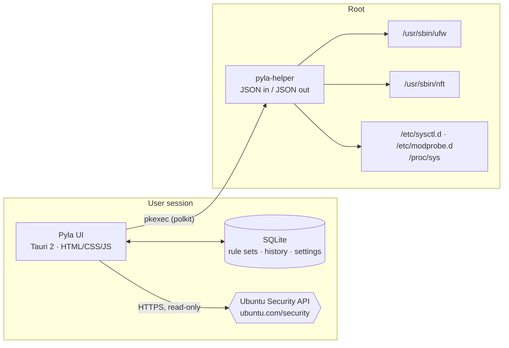

<div align="center">


# Pyla

**A desktop control centre for the Linux firewall — rule sets, live kernel ruleset, and CVE-aware hardening.**

Project site: <https://pyla.space> · Code, issues and releases: <https://github.com/pyla-dev/pyla>

[](https://www.rust-lang.org/)
[](https://tauri.app/)
[](https://ubuntu.com/)
[](LICENSE)
[](#project-status)

[Features](#features) ·
[Architecture](#architecture) ·
[Security model](#security-model) ·
[CVE mitigations](#cve-intelligence-and-temporary-mitigations) ·
[Installation](#installation) ·
[Credits](#credits)

</div>

---

## Overview

Pyla turns [UFW](https://launchpad.net/ufw) into a set-based firewall manager with a native desktop UI.
Instead of editing rules one command at a time, you keep **named rule sets** — *Home*, *Travel*, *Office* —
in a local database, toggle individual rules on and off, preview the exact `ufw` commands, and apply a whole
set atomically with automatic rollback.

Beyond rule management, Pyla gives you a **read-only view of the complete nftables ruleset** (UFW, Docker,
libvirt and kernel tables, with live counters) and a **CVE panel** that tracks open Ubuntu kernel
vulnerabilities for the exact kernel you are running — and, where a subsystem can be safely switched off,
offers a one-click, fully reversible **temporary mitigation** until the patched kernel lands.

## Features

| | Capability | Details |
|---|---|---|
| 🗂️ | **Rule sets** | Unlimited named sets stored in SQLite; per-rule enable/disable, reordering, duplication, import from the live UFW state. |
| 🔍 | **Preview & apply** | Diff between live and desired state, the exact `ufw` commands, then an atomic apply with backup and automatic rollback on any mismatch. |
| 🧾 | **Apply history** | Every apply is logged with its outcome, command log and before/after snapshot. |
| 🧱 | **Full kernel ruleset** | Read-only `nft list ruleset` browser: tables and chains grouped by owner (UFW, Docker, libvirt, kernel), packet/byte counters, filter, clickable `jump`/`goto` targets. |
| 🛡️ | **CVE intelligence** | Live data from the Ubuntu Security API: watched CVEs plus open *high*/*critical* kernel CVEs for your release, with a verdict computed against the installed kernel package. |
| 🩹 | **Temporary mitigations** | Subsystem-level, reversible hardening (sysctl or module blocking) for kernel CVEs that are still unpatched, with an exposure check before and after. |
| 🔐 | **Least privilege** | The UI never runs as root. A small, audited helper is invoked through polkit and accepts only validated, allow-listed operations. |

## Architecture



The workspace is split into three crates:

| Crate | Role |
|---|---|
| [`crates/pyla-core`](crates/pyla-core) | Pure logic, no side effects: rule model and validation, parser of UFW `### tuple ###` lines, apply planner, nftables text parser, CVE-to-subsystem classifier and mitigation registry. Shared by the app and the helper. |
| [`crates/pyla-helper`](crates/pyla-helper) | The only privileged component. Commands: `status`, `apply`, `enable`, `disable`, `ruleset`, `mitigate`. Runs binaries by absolute path with a cleared environment and never through a shell. |
| [`src-tauri`](src-tauri) | The desktop application: Tauri commands, SQLite persistence, Ubuntu Security API client. |
| [`ui`](ui) | Framework-free front end (no bundler, strict CSP). |
| [`packaging`](packaging) | polkit policy, helper installer, desktop entry installer. |

## Security model

Pyla manages a security boundary, so it is designed to be boring and auditable.

- **Privilege separation.** The GUI runs as the logged-in user. Root operations go through `pyla-helper`,
  installed at a fixed path and authorised by a dedicated polkit action (`auth_admin_keep`).
- **No shell, no free-form input.** Every rule is parsed and validated in `pyla-core` before it becomes an
  argument vector; mitigations are referenced only by registry identifier, so no module name or sysctl key
  ever crosses the privilege boundary from the UI.
- **Transactional apply.** Before changing anything the helper snapshots `user.rules` / `user6.rules`
  (last 30 kept under `/var/lib/pyla/backups`). If a command fails or the resulting state differs from the
  requested set, the snapshot is restored and UFW reloaded.
- **Bounded input.** Requests are size-limited and rule counts capped.
- **Read-only by default.** The kernel ruleset view and all CVE checks never modify the system.

> [!NOTE]
> Pyla deliberately leaves `before.rules`, `after.rules`, Docker and libvirt chains untouched, and refuses
> to apply while route or application-profile rules exist in UFW, rather than silently discarding them.

## CVE intelligence and temporary mitigations

The CVE panel queries the [Ubuntu Security API](https://ubuntu.com/security/cves) for the running release
and the source package of the running kernel, then compares Ubuntu's fixed version with the installed one
using `dpkg --compare-versions`:

| Verdict | Meaning |
|---|---|
| `vulnerable` | No fix installed — Ubuntu marks the CVE as *needed* or *pending*. |
| `fixed: update` | A fix has been released but is not installed yet; upgrade the kernel and reboot. |
| `fixed` | The installed kernel already contains the fix. |
| `not affected` | Ubuntu reports this release as unaffected. |

Mitigations are **per subsystem, not per CVE**: a CVE whose patch title starts with `sctp:`, `mptcp:`,
`Bluetooth:`, `io_uring:` … is matched automatically, so new CVEs in the same area are covered without
code changes.

| Mitigation | Mechanism | Trade-off |
|---|---|---|
| MPTCP off | `net.mptcp.enabled = 0` | Applications fall back to plain TCP. |
| io_uring off | `kernel.io_uring_disabled = 2` | Software that requires io_uring must fall back or fails. |
| SCTP, TIPC, RDS, ATM, L2TP, CAN | module blocked (`blacklist` + `install … /bin/false`), unloaded if possible | The protocol becomes unavailable. |
| ksmbd, nfsd | module blocked | The host can no longer act as an in-kernel SMB / NFS server. |
| Bluetooth | module blocked | Bluetooth stops working (full effect after reboot). |
| KVM | check only | Reports whether KVM guests are running; nothing to switch off safely. |

All mitigations live in exactly two files owned by Pyla —
`/etc/sysctl.d/90-pyla-mitigations.conf` and `/etc/modprobe.d/pyla-mitigations.conf` — persist across
reboots, and are removed with **Undo mitigation**. Each one shows the evidence it is based on (live sysctl
value, module loaded or blocked, listening IPv4 TCP sockets for network-facing issues) before you act.

> [!IMPORTANT]
> A mitigation reduces the attack surface; it does not fix the vulnerability. The only complete remedy is the
> patched kernel from your distribution, followed by a reboot.

## Installation

### Requirements

- Ubuntu (tested on 26.04) with UFW and nftables
- Rust toolchain (stable) and the [Tauri 2 prerequisites](https://tauri.app/start/prerequisites/)
  (`libwebkit2gtk-4.1-dev`, `libgtk-3-dev`, …)
- `polkit` / `pkexec`

### Build and install

```sh
git clone https://github.com/pyla-dev/pyla.git
cd pyla

cargo test                                  # unit tests (no root, no network)
cargo build --release                       # app + helper

sudo packaging/install-helper.sh            # privileged helper + polkit policy
pkexec /usr/local/libexec/pyla/pyla-helper status   # smoke test

packaging/install-desktop.sh                # adds Pyla to the application menu (per user)
```

Re-run `sudo packaging/install-helper.sh` whenever the helper changes; the app detects an outdated helper
and tells you so. To remove it: `sudo packaging/install-helper.sh --uninstall`.

For development use `cargo tauri dev`; `cargo tauri build` produces a `.deb` in
`target/release/bundle/deb/`.

### Optional tests that touch the real system

```sh
cargo test -p pyla-core -- --ignored --nocapture   # mitigation checks on this host
cargo test -p pyla      -- --ignored --nocapture   # live Ubuntu Security API query
```

## Usage

1. **Import from UFW** to create a set from the rules currently loaded.
2. **Duplicate** it to build variants; enable, disable, add or reorder rules.
3. **Preview & apply** shows the difference and the exact commands before anything changes.
4. **Full ruleset** shows what the kernel actually enforces, including Docker and libvirt.
5. **CVE** lists the vulnerabilities affecting your kernel; **Mitigate** applies a reversible safeguard
   where one exists.

## Project status

Pyla is an **early preview**. The user interface is currently in Italian; an English localisation is
planned. Roadmap:

- [ ] English UI and i18n
- [ ] `.deb` packaging with the helper and polkit policy
- [ ] Native nftables backend (own table, UFW optional)
- [ ] `[UFW BLOCK]` journal viewer and per-rule hit counters
- [ ] Timed auto-rollback after apply

## Credits

Pyla is maintained by the **pyla-dev** organisation. The design and implementation were produced
with **Claude** (Anthropic) working in Claude Code, under human direction, review and real-world
validation on production machines.

## Maintainers

Project governance, releases and security triage: **pyla-dev** — <https://github.com/pyla-dev>.
Questions and security reports: <maintainers@pyla.space>.

## License

Released under the [MIT License](LICENSE).

Copyright (c) 2026 The PYLA Project Authors.
